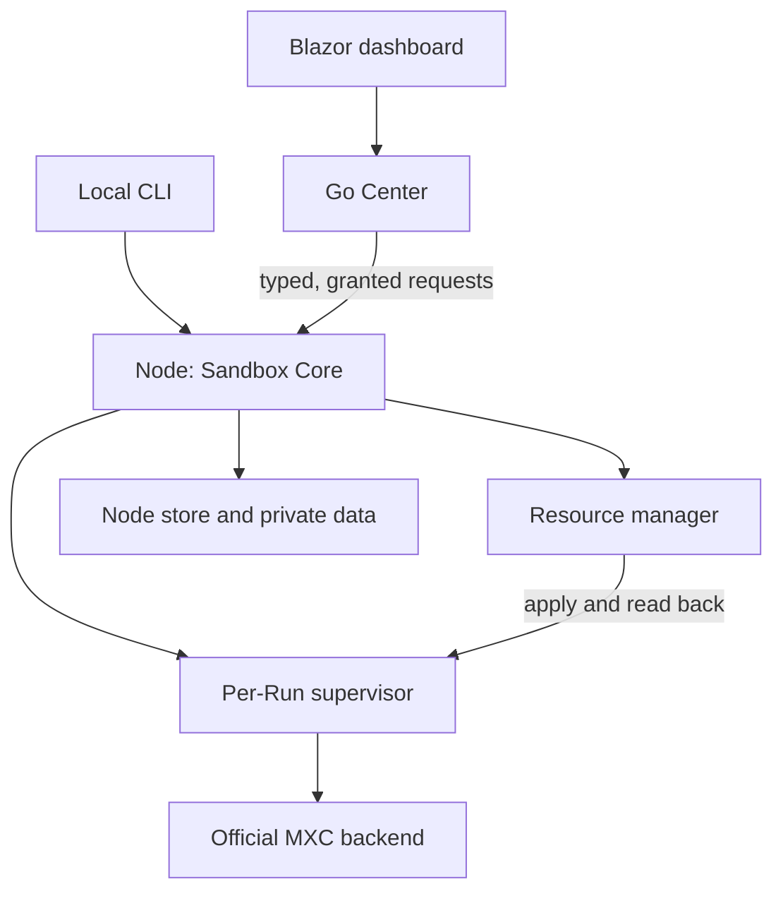

# 01 — System architecture

## Boundaries and processes

| Component | Responsibility | Durable authority | Failure consequence |
|---|---|---|---|
| CLI | Parse explicit argv, render native terminal, local Sandbox/Run/data/resource commands | None; command IDs survive client retry | Client loss detaches; never implicitly kills a detached Run |
| Node | Authenticate local principal, coordinate Sandbox Core, resource budgets, store and optional Center channel | Node SQLite and private data root | Existing per-Run supervisors remain managed; reconciliation precedes new admission |
| Sandbox Core | One authorization/admission/configuration/state implementation used locally and remotely | Transactional commands, config revisions and Run snapshots | Reject when identity, confinement or limit application is uncertain |
| RunSupervisor | Own one Run's official MXC execution, confinement/lifetime handles, terminal and bounded output spool | Run identity/epoch and supervisor journal | Fail closed by OS ownership; no unowned payload is deliberately left alive |
| Resource manager | Host/managed observation, headroom, desired budgets, applied limits/readback and pressure decisions | Policies plus diagnostic samples | Freeze increases or refuse new admission when authoritative readings fail |
| MXC adapter | Translate admitted profiles into stable official SDK/executor requests | No independent business state | Unsupported policy is refused, never silently weakened |
| Go Center | Identity, enrollment, outbound channel, typed remote routing, entitlement and audit | PostgreSQL; Node remains execution authority | Local execution continues; uncertain remote mutations are reconciled |
| Blazor Web | Responsive remote management over authenticated Center APIs | No process or credential authority | Show stale/offline/unknown states honestly |

The Center cannot start a host process directly. All mutation semantics terminate in Sandbox Core, with the same revision checks, managed-use locks, path resolution, capability evaluation and resource budget as the local path. Local IPC is protected by OS user identity, not an assumption that loopback is trusted.

## Implementation distribution

Keep C#/.NET Native AOT for Node, CLI, supervisor, shared model and adapters. Keep Go for Center and PostgreSQL for its store. Use the existing Blazor browser-capable Web structure; static assets and API origin configuration fit the existing Cloudflare deployment shape. UI is not a new C# Center server.

Core cannot reference Cloud account/commerce libraries, Web, AI or desktop/mobile packages. Center transport depends on narrow core facades, not vice versa. MXC-specific types stay inside the platform adapter. Contracts carry stable ArcForges semantics and actual capability reports; they do not leak native handles or raw command-launch RPCs.

One sandbox may host several concurrent runs, up to explicit policy. Its data persists while each run's isolation/execution is separately owned. Aggregate policy is enforced by summed grants and verified OS limits; it does not imply the MXC SDK owns CPU or memory governance. See [03](03-sandbox-run-model.md), [04](04-resource-management.md), and [07](07-lifecycle-recovery.md).

## Admission and extension boundary

SDK/executor versions are pinned together with platform prerequisites, source and package hashes, licenses, schema and capability receipts. No compatibility-by-version inference, private SDK fork, generic plugin registry or speculative extension interfaces. There are exactly the Windows and Linux adapters required by current profiles. Backend differences are visible in inspect, including memory metric type, terminal and network capabilities.

The architecture can be implemented only after the [engine experiments](../verification/mxc-experiments.md) prove its combinations. Capability-dependent code may be developed without claiming support; final release cannot skip a required experiment.
