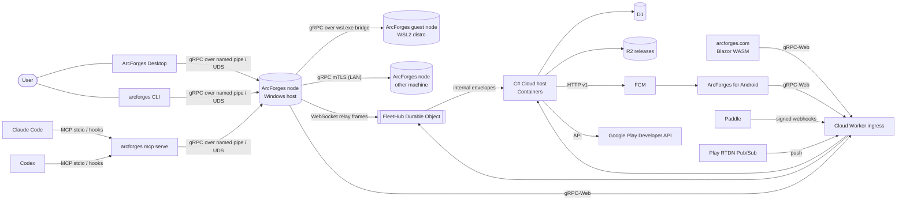

# 01 — System overview

## 1. Context

## 2. Components and responsibilities

| Component | Repository / project | Responsibility | Authority |
|---|---|---|---|
| Node service | ArcForges `ArcForges.Host` (role `node run`) with `ArcForges.Node.*` | Execution, admission, enforcement, records, diagnosis, memory, storage, caches, toolchains, sessions, policy, LAN peer, cloud link, updates | Execution and resource state of its machine/environment |
| Guest node | Same binary inside a WSL2 distro, systemd user unit | Linux execution and enforcement for that distro; linked to the host node | State of executions in that distro |
| CLI | ArcForges `ArcForges.CommandLine` (role default) | Human and script access; auto-starts the node | None (client) |
| MCP adapter | ArcForges `ArcForges.Mcp` (role `mcp serve`) | MCP protocol to node gRPC translation | None (client) |
| Hook handler | ArcForges `ArcForges.Integrations` (role `hook`) | Client hook payloads → session registry and routing decisions | None (client) |
| WSL bridge | ArcForges (role `bridge wsl`) | Byte relay between `wsl.exe` stdio and the guest socket | None |
| Desktop | ArcForges `ArcForges.Desktop` | Visual control centre and tray | None (client) |
| Shared client library | ArcForges `ArcForges.Client` | Connection, auto-start, compatibility handshake and stream reconciliation cache used by the CLI, Desktop and MCP adapter | None |
| Cloud host | Cloud `ArcForges.Cloud` with modules | Identity, devices and nodes, fleet, commands, entitlement, commerce, notification, support, audit, configuration | Account, registry, entitlement, commerce, remote commands, push |
| Relay adapter | Cloud `worker/relay` (TypeScript, thin) | Hibernating WebSocket termination, token validation, frame routing, bounded caches | Transient routing state only |
| Web | Web `ArcForges.Web.Site` and `ArcForges.Web.App` (profiles) | Product site, downloads, account, devices, subscription, fleet view, activation and pairing approval | None (client) |
| Android app | Mobile `ArcForges.Mobile` | Fleet view, notifications, confirmed actions, pairing, Play subscription | None (client) |
| Contracts | Contracts `public/proto/arcforges/{node,fleet}/v1`, `internal/proto/arcforges/{peer,relay}/v1` | Canonical wire definitions and generated C# packages | Wire meaning |
| Platform building blocks | DesktopPlatform `ArcForges.LocalRpc`, `.Persistence.Sqlite`, `.Security*`, `.Observability`, `.Foundation`, `.DesignSystem`, `.Desktop.Shell` | Local gRPC transport, SQLite store mechanics, secrets, audit, telemetry primitives, design tokens and shell models | Mechanisms only |

## 3. Deployment topologies

| Topology | Nodes | Notes |
|---|---|---|
| T1 Single machine (Windows) | One host node | Free tier; no cloud needed |
| T2 Windows + WSL | Host node + one guest node per linked distro | Free tier. The guest link runs over the `wsl.exe` bridge, and one fair queue spans host and guests (AD-0005) |
| T3 Single machine (Linux) | One node (systemd user unit) | Free tier |
| T4 LAN | Several nodes (each possibly with guests), paired | Free: pairing, status, placement and compiler-cache sharing need no account |
| T5 Remote | Any of the above + cloud relay; web and Android viewers | Pro (cloud services) |

## 4. Trust boundaries and data classes

| Boundary | Crossing | Protection |
|---|---|---|
| B0 Node ↔ its own workload objects (added 2026-10-19) | Same-user access to the jobs, ack events, cgroup files and records ArcForges creates for workloads | **GUARDRAIL** for every workload: same-user code can reach these objects ([11](11-security-privacy.md) §1, T-22; V-W11). Release 1 confines no workload, so no workload is kept from them |
| B1 Local user ↔ node | Named pipe / UDS | Same-user ACL / mode 0700 + peer credential; client hello |
| B2 Host ↔ guest | `wsl.exe` stdio bridge → guest UDS | Launched by the same Windows user; guest checks uid; link token |
| B3 Node ↔ node | TCP | mTLS 1.3 with pinned certificates from pairing (account-issued certificates are roadmap RM-01); per-peer policy |
| B4 Node ↔ cloud | HTTPS gRPC-Web; WSS relay | Device credential; short-lived relay token; signed commands verified by the node |
| B5 Browser/phone ↔ cloud | HTTPS gRPC-Web | Account session (cookie + CSRF for web; bearer for native) |
| B6 Cloud ↔ providers | HTTPS | Provider-specific verification (Paddle HMAC, Pub/Sub push auth, Google OAuth service account) |
| B11 AI client ↔ node routes (added 2026-10-19) | MCP adapter, hook handler, CLI calls from agent shells | Origin classification only: a **GUARDRAIL** until the caller's identity is OS-enforced, which it is not in release 1 ([11](11-security-privacy.md) §1). Routed commands run outside the client's own sandbox; the client's own process keeps the user's access (T-24; V-A03) |

There is no boundary between the node and an unconfined workload: every managed process runs as the signed-in user (B0; [11](11-security-privacy.md) §1–§2).

| Data class | Examples | Leaves the node? |
|---|---|---|
| D0 Public | Version, OS family, capability flags | Yes (relay summary) |
| D1 Operational summary | CPU/memory percentages, task counts, task titles chosen by caller, states, durations | To relay only while the user is signed in and remote access is enabled; only to the user's viewers |
| D2 Sensitive execution detail | Command lines, environment, working directories, output, file paths | Only on an explicit viewer request where node privacy policy allows; never stored in the cloud beyond the bounded relay buffer |
| D3 Secrets | Credentials, tokens, secret environment values | Never; redacted in records and exports |
| D4 Workspace content | Source, artifacts | LAN peers only per peer policy; never to the cloud |

## 5. Repository and project map

| Repository | New or changed projects |
|---|---|
| ArcForges (new) | `src/ArcForges.Host`, `ArcForges.Supervisor` (Windows only), `ArcForges.Setup` (Windows per-user setup program), `ArcForges.Node.Core`, `ArcForges.Node.Store`, `ArcForges.Node.Platform`, `ArcForges.Node.Platform.Windows`, `ArcForges.Node.Platform.Linux`, `ArcForges.Node.Api`, `ArcForges.Node.Toolchains`, `ArcForges.Node.Storage`, `ArcForges.Node.Diagnosis`, `ArcForges.Node.Peer`, `ArcForges.Node.CloudLink`, `ArcForges.Node.Updates`, `ArcForges.Client`, `ArcForges.CommandLine`, `ArcForges.Mcp`, `ArcForges.Integrations`, `ArcForges.Desktop`, `ArcForges.Desktop.ViewModels`; `installer/linux` (`install.sh`, `.deb` packaging); `tests/*`; `tools/ArcForges.TestLoad` (load and fault generator used by tests), `tools/ArcForges.Bench` (performance benchmarks) |
| Contracts | `public/proto/arcforges/node/v1/*.proto`, `public/proto/arcforges/fleet/v1/*.proto`, `internal/proto/arcforges/peer/v1/*.proto`, `internal/proto/arcforges/relay/v1/*.proto`, `internal/proto/arcforges/operator/v1/operator_read.proto`; packages `ArcForges.Contracts.Node`, `.Fleet`, `.Peer`, `.Relay`; additive changes to `publicapi.v1` (reuse map); `ArcForges.Cli` tool command renamed (conflict C-03) |
| DesktopPlatform | `ArcForges.LocalRpc` (service endpoint mode, stream lane, limit profiles, peer identity provider); `ArcForges.Security.Secrets` (Linux backends) |
| Cloud | `ArcForges.Cloud.Modules.Fleet` (new). Implementations, new on the reused contracts and schema: `Modules.Identity` endpoints, `Modules.Devices`, `Modules.Entitlement` endpoints, `Modules.Commerce` (Paddle and Google Play providers), `Modules.Notification` (FCM sender), `Modules.Support`, `Modules.Audit`, `Modules.Configuration` (kill switches), operating budgets, operator endpoints. D1 migrations; `worker/relay/*` (thin DO adapter); the local Container shim ([16](16-testing-strategy.md) §3.1) |
| Web | `ArcForges.Web.Site` (product pages, downloads), `ArcForges.Web.App` profiles `account` (adapted) and `fleet` (new) |
| Mobile | `ArcForges.Mobile` app (fleet, notifications, pairing, billing), `ArcForges.Mobile.Network` (gRPC-Web clients), `ArcForges.Mobile.Security` (credential storage) |

## 6. Key flows (summaries; full sequences in the architecture chapters)

1. **Submit and run (CLI).** `arcforges run -- dotnet build`:
   1. The CLI connects (and auto-starts the node if absent) and sends `TaskService.SubmitTask` with a command ID.
   2. The node persists the task and journals `TaskSubmitted`, then the scheduler admits it when the budget allows.
   3. The supervisor launches the process suspended into a job or cgroup, attaches log files and resumes it. The CLI is attached with `TaskService.AttachTask`, streaming output and state.
   4. The exit status is recorded with its timeline, and the CLI exits with the task's exit code.
2. **Agent build (MCP).**
   1. Claude Code calls the MCP `run` tool, and the adapter calls `SubmitTask` with `owner=session`.
   2. It then calls `WaitTask` with a bounded wait of 45 s. If the task is still running, the tool returns the handle and an output tail.
   3. The agent later calls `task_wait`, `task_output` or `task_status`.
3. **Desktop live view.** The Desktop subscribes with `NodeEventService.Subscribe(topics)`, renders the snapshot and applies incremental events. On reconnect it resumes from its cursor, or receives a reset with a fresh snapshot.
4. **Remote cancel (Android).**
   1. The phone calls `FleetService.SendNodeCommand(CANCEL_TASK)`, and C# authorizes, records, signs and forwards it to `FleetHub`.
   2. The node verifies the signature and its remote-control policy, then cancels the task.
   3. The result returns signed. The phone watches the command status and the node's task state through `WatchFleet`.
5. **LAN placement.**
   1. The origin scores candidates, then calls `PlacementService.RequestOffer` and `AcceptOffer` on the chosen peer.
   2. Inputs flow through `TransferService`, and the peer calls `StartRemoteAttempt`.
   3. The origin watches with `WatchRemoteAttempt`, then fetches the outputs.
