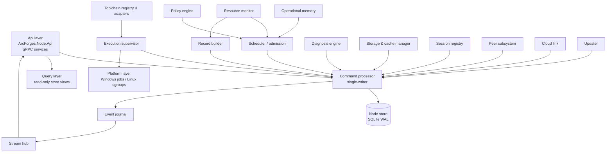

# 02 — Node service

## 1. Internal structure

| Subsystem | Project | Responsibility |
|---|---|---|
| Api layer | `ArcForges.Node.Api` | Generated gRPC service implementations; request validation; client hello and compatibility; mapping to commands and queries; `ArcError` mapping |
| Command processor | `ArcForges.Node.Core` | Serializes every state mutation through one writer loop (a bounded channel, capacity 4,096). It executes a command against the store in one transaction, appends journal events in the same transaction, then publishes them to the stream hub. It records idempotency receipts (`command_journal`). |
| Query layer | `ArcForges.Node.Core` | Read-only connections (WAL readers) for lists, gets and reports; never blocks the writer |
| Event journal & stream hub | `ArcForges.Node.Core` | Monotonic `event_seq` per node within `stream_generation`; fan-out to subscribers with per-subscriber bounded buffers (default 2,048 events; overflow → reset) |
| Scheduler / admission | `ArcForges.Node.Core` | Pools, priorities, fair share, dependencies, budgets, grants ([03](03-resource-control.md)) |
| Execution supervisor | `ArcForges.Node.Core` + platform | Launch, attach, monitor, cancel, timeouts, re-attach after restart, exit normalization ([04](04-execution.md)) |
| Resource monitor | `ArcForges.Node.Platform.*` | Machine and per-execution sampling; capacity and unmanaged-load estimation |
| Record builder | `ArcForges.Node.Diagnosis` | Timeline segments, samples, process records ([07](07-records-diagnosis-memory.md)) |
| Diagnosis engine | `ArcForges.Node.Diagnosis` | Periodic checks, findings, remedies under policy |
| Operational memory | `ArcForges.Node.Diagnosis` | Facts and estimates |
| Storage & cache manager | `ArcForges.Node.Storage` | Managed roots, ownership, quotas, analysis, cleanup, cache registry, CAS |
| Toolchain registry & adapters | `ArcForges.Node.Toolchains` | Detection, classification, environment and concurrency shaping, phase detection |
| Session registry | `ArcForges.Node.Core` | Agent sessions, subagents, client connections, process ancestry roots |
| Policy engine | `ArcForges.Node.Core` | Revisioned policy documents, effective-policy evaluation per scope |
| Peer subsystem | `ArcForges.Node.Peer` | Discovery, pairing, mTLS listener, placement, transfer, cache endpoint, guest links |
| Cloud link | `ArcForges.Node.CloudLink` | Sign-in flows, device credential, entitlement token, relay connection, command verification |
| Updater | `ArcForges.Node.Updates` | Manifest checks, staging, switching, health check, rollback |

**Concurrency rules.**
- Only the command processor writes the store.
- Subsystems submit commands and read through the query layer.
- Long operations (storage analysis, cleanup execution, transfers, doctor) run as **node jobs** with their own records. They report progress through commands, never by holding the writer.

## 2. Process lifecycle

### Startup sequence (`arcforges node run`)

1. Resolve the data root (configuration file `node.json` in the platform config directory: `%APPDATA%\ArcForges\node.json` / `~/.config/arcforges/node.json`; default data root per AD-0012).
2. **Single instance.**
   - Windows: create the named mutex `Local\ArcForges.Node.<user-sid-hash>`.
   - Linux: `flock` on `<data root>/node.lock`.

   If another instance holds it, exit with code 3 (`ALREADY_RUNNING`) after printing its endpoint.
3. Open the store, take a pre-migration backup when the schema version changes (`records/backups/store-<from>-<to>-<timestamp>.db`, last 3 kept; [13](13-distribution-updates.md) §6), run forward-only migrations, and verify `PRAGMA integrity_check` (quick mode) on startup after an unclean shutdown.
4. Read the boot identity and compare it with the stored one ([AD-0006](../decisions/AD-0006-execution-semantics.md) §3).
5. **Recovery.** For each attempt in `STARTING`, `RUNNING`, `PAUSING`, `PAUSED` or `STOPPING`, re-open its container (Windows named job; Linux transient unit `arcforges-a-<attempt>.service`):
   - Container present with live processes → re-attach: tail logs from stored offsets, record a `node_gap` segment.
   - Root process finished while the node was down → finalize from the durable exit record `logs/<attempt>/exit.json`:
     - **Linux:** written by `ExecStopPost=arcforges node exit-record`, which systemd runs even without the node (L-13).
     - **Windows:** written by the attempt's holder (`arcforges node exec-wrap`), with the job accounting.
   - **Windows re-open.** Jobs stay openable by name because each attempt's holder keeps the child and root job handles until the node acknowledges the exit (L-14). The node re-associates its completion port (clear, then attach; L-15) and queries limit violations it missed.
   - Container absent and no exit record → `LOST` with evidence (`container_missing`, or `boot_changed` when step 4 found a new boot).
6. Start the platform layer: create or re-open the root container and verify enforcement capabilities. Record `NodeCapabilities`.
   - **Windows:** the root job.
   - **Linux:** connect to the user manager's D-Bus API, check the cgroup v2 hierarchy and the controllers delegated to the user manager, and start `arcforges.slice` with its runtime limits.
   - **Self-test:** create a probe container, apply limits and read them back.
7. Start the API listener (LocalRpc service endpoint mode):
   - Windows pipe `\\.\pipe\arcforges-<user-sid-hash>-node`.
   - Linux `$XDG_RUNTIME_DIR/arcforges/node.sock`, or `<data root>/run/node.sock` when `XDG_RUNTIME_DIR` is unset, with a 0700 directory.

   Write the endpoint descriptor `<data root>/run/endpoint.json` (pipe/socket path, node ID, PID, start time, contract version) atomically.
8. Start the scheduler, monitor, diagnosis timers, storage housekeeping, peer subsystem (if enabled) and cloud link (if signed in).
9. Journal `NodeStarted` and report readiness: Linux systemd `READY=1` via `sd_notify`; Windows sets the named event `Local\ArcForges.Node.<hash>.Ready`.

### Shutdown (`arcforges node stop`, OS logoff, or update switch)

1. Stop accepting new API calls with `UNAVAILABLE` + retry advice `AFTER_TIME` (2 s).
2. Stop admissions. Leave running executions running unless they are `kill_with_node`; their guards take over the disk limits (06 §5).
3. Flush the record builder and sampler buffers, checkpoint WAL, write a clean-shutdown marker, release the lock and exit 0.
4. Shutdown must complete within 10 s; the OS may kill the process afterwards, and the next start recovers.

### Crash

No in-memory state is authoritative. The next start performs the recovery in step 5. A supervisor restarts the node:
- **Windows:** the supervisor `arcforges-supervisor.exe` ([13](13-distribution-updates.md) §3.1). Backoff 2 s, 5 s, 10 s; after 5 crashes in 10 minutes it stops restarting and records `node_crash_loop` in its log, and the next client auto-start tries again.
- **Linux:** the systemd unit (`Restart=on-failure`, `RestartSec=2`, start limit 5 in 10 minutes).

Executions are unaffected on both platforms: they run in their own containers, not as children of the node process. Their disk limits stay enforced while the node is down: the attempt guards take over after `storage.guard_takeover_ms` ([06](06-storage-workspaces.md) §5).

Once recovery (step 5) is done and each monitor started in step 8 has completed a cycle, the node renews its heartbeat, `run/node-heartbeat`, every second from its enforcement loop: its instance ID and an increasing sequence number. The guards read it ([06](06-storage-workspaces.md) §5). On Linux the same loop pings systemd's watchdog once the node is ready. On Windows the supervisor restarts a node whose heartbeat stalls for 30 s, counting from its first heartbeat. Both stop when the cache store no longer answers its probe.

## 3. Endpoint discovery and auto-start (clients)

`ArcForges.Client` resolves the endpoint:

1. Look for `ARCFORGES_ENDPOINT` (testing only).
2. Read `run/endpoint.json` and verify the PID is alive and the start time matches.
3. Otherwise use the default pipe/socket path.

If the connection fails with not-found or refused, the client starts the node detached:
- Windows: `CreateProcess` of `app\current\arcforges-supervisor.exe` with `DETACHED_PROCESS | CREATE_NEW_PROCESS_GROUP | CREATE_BREAKAWAY_FROM_JOB`. The breakaway is used only when the client itself runs inside a job that allows it. Otherwise the client asks the user to start the node: inside AI-client sandboxes or CI jobs, auto-start is refused with `NODE_NOT_RUNNING` and guidance.
- Linux: `systemctl --user start arcforges-node.service`, falling back to `setsid` launch only when systemd is absent.

The client waits for readiness up to 5 s (CLI) or 15 s (Desktop, MCP adapter), then performs the **client hello** (`NodeService.Hello`): client kind, version, contract version, process ID and, for the MCP adapter and hooks, the agent process hints.

## 4. Configuration

| Source | Content | Owner |
|---|---|---|
| `node.json` (file) | Data root, log level, telemetry consent (`NodeService.GetNodeSettings`/`UpdateNodeSettings`) | User (CLI `arcforges config`, Desktop Settings) |
| Store `policy_document` | All behavioural policy: budgets, pools, routing, approvals, remote control, privacy, retention, LAN (enabled, port, advertisement), updates (mode, channel, window) | Policy engine (revisioned) |
| Store `node_setting` | Node name, root relocations, feature toggles | Node |
| Environment `ARCFORGES_*` | Test hooks only (endpoint override, fake clock), honoured only by debug builds or with `--test-mode` | Tests |

## 5. Logging and telemetry

- Structured logs (JSON Lines) rotate at 10 MB × 5 files in `<data root>/logs/node/`, written through the DesktopPlatform `ArcForges.Observability` redaction processor. Command lines and environment values are logged only at `debug` level, and always through redaction.
- Local metrics (counters, gauges, histograms) are exposed through `NodeService.GetHealth` and the Diagnosis page. No telemetry leaves the node unless the user opts in. Opt-in sends only anonymous aggregate counters (D0), daily.

## 6. Self-protection

- The node runs at normal priority, outside its root container: outside the root job on Windows, and on Linux in its own unit, outside `arcforges.slice`. Managed load therefore cannot starve the scheduler, and the user headroom also protects the node.
- Every API call has a deadline and per-client admission (LocalRpc lanes). Streams have heartbeat and idle limits.
- The store has a size guard: if the data volume has less than 1 GiB free, the node rejects new submissions with `RESOURCE` + `disk_space` and raises a finding. Running executions continue.
