# State machines

Generated by `tools/check_design.py --write` from [machines.json](machines.json). Do not edit by hand.
States equal the named proto enum values (without the enum prefix); pseudo-states are marked.

| ID | Machine | Enum | Persisted | Owner |
|---|---|---|---|---|
| [SM-TASK](#sm-task) | Task | `arcforges.node.v1.TaskState` | node store task.state | Scheduler |
| [SM-ATTEMPT](#sm-attempt) | Attempt | `arcforges.node.v1.AttemptState` | node store attempt.state | Supervisor |
| [SM-FINDING](#sm-finding) | Finding | `arcforges.node.v1.FindingState` | node store finding.state | Diagnosis |
| [SM-NODE](#sm-node) | Node lifecycle | `arcforges.node.v1.NodeLifecycleState` | in memory; journaled as NodeStatusChanged events | Host |
| [SM-GUEST-LINK](#sm-guest-link) | WSL guest link (host side): retired 2026-10-21 by AD-0018, never entered; kept as history | `arcforges.node.v1.GuestLinkState` | node store guest_link.state (retired table, never written) | none (the guest manager is retired by AD-0018) |
| [SM-PAIRING](#sm-pairing) | LAN pairing (local confirmation): out of current delivery since 2026-10-28 (AD-0021 §12); kept as history | `arcforges.node.v1.PairingState` | node store pairing.state (secrets in memory) | Peer manager |
| [SM-REMOTE-ATTEMPT](#sm-remote-attempt) | Remote attempt (executor side): out of current delivery since 2026-10-28 (AD-0021 §12); kept as history | `arcforges.peer.v1.RemoteAttemptState` | executor node store remote_attempt.state; origin mirrors as ATTEMPT_KIND_REMOTE | Placement |
| [SM-CLEANUP-PLAN](#sm-cleanup-plan) | Cleanup plan | `arcforges.node.v1.CleanupPlanState` | node store cleanup_plan.state | Cleanup executor |
| [SM-WORKTREE](#sm-worktree) | Managed worktree | `arcforges.node.v1.WorkspaceState` | node store workspace.state (kind MANAGED_WORKTREE) | Workspace manager |
| [SM-SESSION](#sm-session) | AI client session | `arcforges.node.v1.SessionState` | node store session.state | Session service |
| [SM-APPROVAL](#sm-approval) | Approval | `arcforges.node.v1.ApprovalState` | node store approval.state | Approval service |
| [SM-SIGN-IN](#sm-sign-in) | Node browser sign-in (cloud side) | `arcforges.fleet.v1.NodeSignInState` | cloud fleet_node_sign_in.state; node mirrors as SignInFlowState | Fleet module |
| [SM-DEVICE-AUTH](#sm-device-auth) | Device authorization (headless sign-in) | `arcforges.fleet.v1.DeviceAuthorizationState` | cloud fleet_device_authorization.state | Fleet module |
| [SM-PHONE-PAIRING](#sm-phone-pairing) | Phone sign-in by QR | `arcforges.fleet.v1.PhonePairingCloudState` | cloud fleet_phone_pairing.state; node mirrors as PhonePairingState | Fleet module |
| [SM-RELAY](#sm-relay) | Relay connection (node side) (since 2026-10-28 the node's connection to the Go center, AD-0021 §9) | `arcforges.node.v1.RelayState` | in memory; reported in AccountStatus | Cloud link |
| [SM-REMOTE-COMMAND](#sm-remote-command) | Remote command (since 2026-10-28 center-routed signed calls, AD-0021 §10) | `arcforges.fleet.v1.RemoteCommandState` | cloud fleet_remote_command.state; node remote_command_log | Fleet module |
| [SM-SUBSCRIPTION](#sm-subscription) | Subscription (normalized across Paddle and Google Play) | `arcforges.fleet.v1.SubscriptionState` | cloud commerce_subscription (reused) with provider state; fleet_play_purchase.play_state | Commerce module |
| [SM-UPDATE](#sm-update) | Node update | `arcforges.node.v1.UpdateState` | node store update_state.state; run/update-switch.json during a switch | Updater |
| [SM-INTEGRATION](#sm-integration) | AI client integration | `arcforges.node.v1.IntegrationState` | derived from integration_write, client settings and probes (re-evaluated by file watchers) | Integration service |

## SM-TASK — Task

- Enum: `arcforges.node.v1.TaskState`; persisted: node store task.state; owner: Scheduler.
- Initial: `QUEUED`, `WAITING_DEPENDENCY`, `RUNNING`. Terminal: `SUCCEEDED`, `FAILED`, `CANCELLED`, `LOST`.
- Initial guard for `QUEUED`: kind != ADOPTED; ordinary submission.
- Initial guard for `WAITING_DEPENDENCY`: kind != ADOPTED; submission with unmet dependencies.
- Initial guard for `RUNNING`: kind = ADOPTED; successful explicit HUMAN adoption records the synthetic task and its one ADOPTED attempt together.

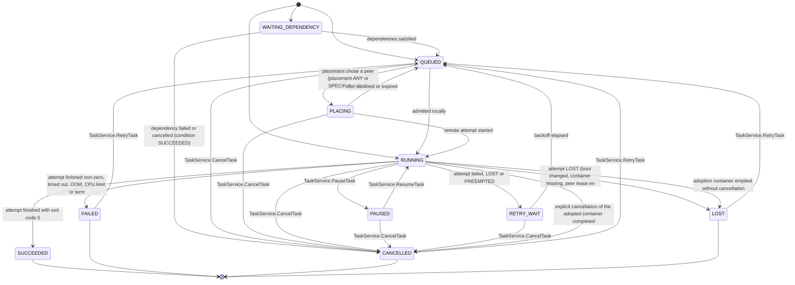

| From | To | Trigger | Guard | Effect |
|---|---|---|---|---|
| WAITING_DEPENDENCY | QUEUED | dependencies satisfied | kind != ADOPTED |  |
| WAITING_DEPENDENCY | CANCELLED | dependency failed or cancelled (condition SUCCEEDED); TaskService.CancelTask | kind != ADOPTED |  |
| QUEUED | RUNNING | admitted locally; attempt created | budget, pool, global limits (03 section 4); kind != ADOPTED |  |
| QUEUED | PLACING | placement chose a peer (placement ANY or SPECIFIC_NODE) | peer policy (no entitlement: LAN is free, AD-0015); kind != ADOPTED |  |
| PLACING | RUNNING | remote attempt started | kind != ADOPTED |  |
| PLACING | QUEUED | offer declined or expired; transfer failed before start | kind != ADOPTED | re-placement; any side-effect class |
| RUNNING | PAUSED | TaskService.PauseTask; pressure freeze | pause SUPPORTED and task pausable; kind != ADOPTED |  |
| PAUSED | RUNNING | TaskService.ResumeTask; pressure recovered | kind != ADOPTED |  |
| RUNNING | SUCCEEDED | attempt finished with exit code 0 | kind != ADOPTED |  |
| RUNNING | RETRY_WAIT | attempt failed, LOST or PREEMPTED | retry rules allow (AD-0006 section 4) and attempts remain; kind != ADOPTED |  |
| RETRY_WAIT | QUEUED | backoff elapsed | kind != ADOPTED |  |
| RUNNING | FAILED | attempt finished non-zero, timed out, OOM, CPU limit or termination incomplete | no retry applies; kind != ADOPTED |  |
| RUNNING | LOST | attempt LOST (boot changed, container missing, peer lease ended) | not retryable; for ADOPTED, its attempt is RUNNING or STOPPING and the boot changed or adoption container cannot be reopened |  |
| QUEUED, PLACING, RUNNING, PAUSED, RETRY_WAIT | CANCELLED | TaskService.CancelTask; session ended (stop_with_session); node shutdown for kill_with_node | kind != ADOPTED |  |
| FAILED, CANCELLED, LOST | QUEUED (reopen) | TaskService.RetryTask | kind != ADOPTED | new attempt number |
| RUNNING | CANCELLED | explicit cancellation of the adopted container completed | kind = ADOPTED; adoption container is empty | one attempt FINISHED with CANCELLED/HAPPENED; no retry |
| RUNNING | LOST | adoption container emptied without cancellation | kind = ADOPTED | one attempt FINISHED with LOST/UNKNOWN; no exit status and no retry |

## SM-ATTEMPT — Attempt

- Enum: `arcforges.node.v1.AttemptState`; persisted: node store attempt.state; owner: Supervisor.
- Initial: `CREATED`, `STARTING`, `RUNNING`. Terminal: `FINISHED`.
- Initial guard for `CREATED`: kind != ADOPTED; remote placement or cache restore.
- Initial guard for `STARTING`: kind = LOCAL; durable local launch intent.
- Initial guard for `RUNNING`: kind = ADOPTED; successful explicit HUMAN adoption, with no command launch.

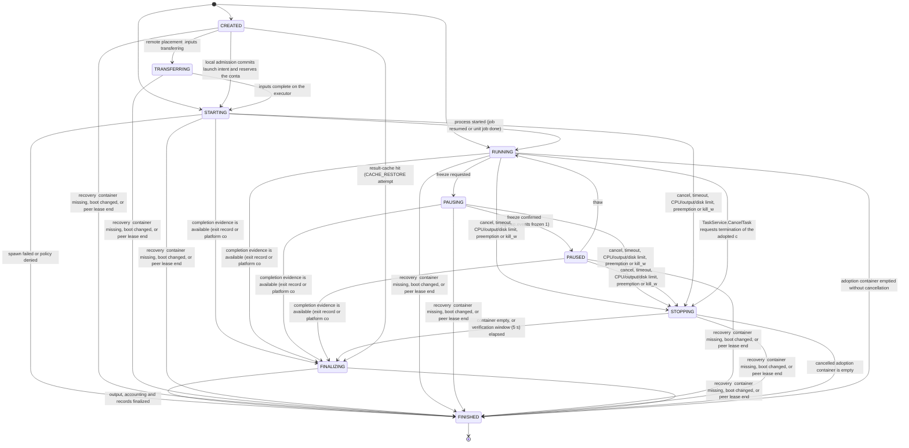

| From | To | Trigger | Guard | Effect |
|---|---|---|---|---|
| CREATED | TRANSFERRING | remote placement: inputs transferring | kind != ADOPTED |  |
| CREATED | STARTING | local admission commits launch intent and reserves the container name (also the initial local state); before creating the OS container | kind != ADOPTED |  |
| TRANSFERRING | STARTING | inputs complete on the executor | kind != ADOPTED |  |
| STARTING | RUNNING | process started (job resumed or unit job done) | kind != ADOPTED |  |
| STARTING | FINISHED | spawn failed or policy denied | kind != ADOPTED | termination SPAWN_FAILED or POLICY_DENIED; effect DID_NOT_HAPPEN |
| RUNNING | PAUSING | freeze requested | kind != ADOPTED |  |
| PAUSING | PAUSED | freeze confirmed (cgroup.events frozen 1) | kind != ADOPTED |  |
| PAUSED | RUNNING | thaw | kind != ADOPTED |  |
| RUNNING, PAUSING, PAUSED | STOPPING | cancel, timeout, CPU/output/disk limit, preemption or kill_with_node shutdown | kind != ADOPTED | commit STOPPING with the pending cause and redacted detail before applying the platform stop; a restart continues that stop (architecture 04 sections 6 and 9) |
| STARTING | STOPPING | cancel, timeout, CPU/output/disk limit, preemption or kill_with_node shutdown while launch is pending | kind != ADOPTED | commit STOPPING with the pending cause and redacted detail before applying the platform stop; a restart continues that stop (architecture 04 sections 6 and 9) |
| STARTING, RUNNING, PAUSING, PAUSED | FINALIZING | completion evidence is available (exit record or platform completion); a fast root can exit before RUNNING is published | kind != ADOPTED | end steps and leftover rundown precede the exit evidence; persist FINALIZING before final output/accounting/result recording |
| STOPPING | FINALIZING | container empty, or verification window (5 s) elapsed | kind != ADOPTED | retain the pending stop cause and detail; TERMINATION_INCOMPLETE when processes remain; persist before final result recording |
| CREATED | FINALIZING | result-cache hit (CACHE_RESTORE attempt; RESTORE mode is roadmap RM-04, not in release 1) | kind != ADOPTED |  |
| FINALIZING | FINISHED | output, accounting and records finalized | kind != ADOPTED |  |
| CREATED, TRANSFERRING, STARTING, RUNNING, PAUSING, PAUSED, STOPPING, FINALIZING | FINISHED | recovery: container missing, boot changed, or peer lease ended | for ADOPTED, only RUNNING or STOPPING; boot changed or adoption container cannot be reopened | termination LOST; effect UNKNOWN |
| RUNNING | STOPPING | TaskService.CancelTask requests termination of the adopted container | kind = ADOPTED | record and journal STOPPING in the cancel command; no command launch or managed end steps |
| STOPPING | FINISHED | cancelled adoption container is empty | kind = ADOPTED | termination CANCELLED; effect HAPPENED; no captured exit code, output or managed FINALIZING phase |
| RUNNING | FINISHED | adoption container emptied without cancellation | kind = ADOPTED | termination LOST; effect UNKNOWN; node is not the parent and has no exit status |

## SM-FINDING — Finding

- Enum: `arcforges.node.v1.FindingState`; persisted: node store finding.state; owner: Diagnosis.
- Initial: `OPEN`. Terminal: `RESOLVED`, `AUTO_RESOLVED`.

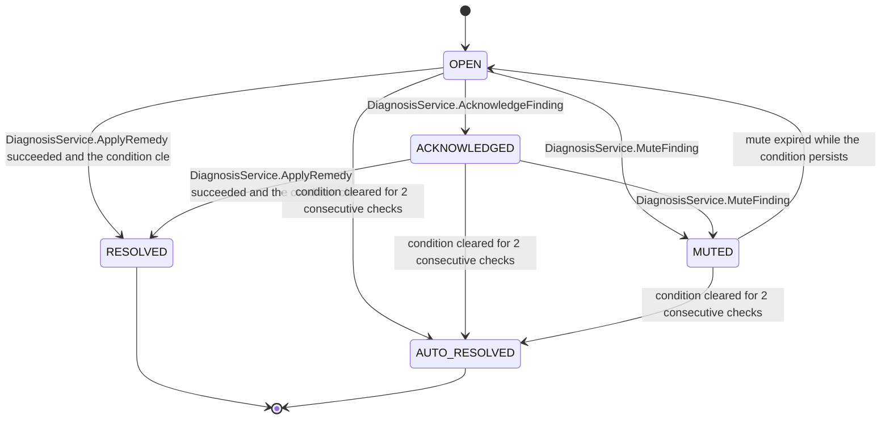

| From | To | Trigger | Guard | Effect |
|---|---|---|---|---|
| OPEN | ACKNOWLEDGED | DiagnosisService.AcknowledgeFinding |  |  |
| OPEN, ACKNOWLEDGED | MUTED | DiagnosisService.MuteFinding |  |  |
| MUTED | OPEN | mute expired while the condition persists |  |  |
| OPEN, ACKNOWLEDGED | RESOLVED | DiagnosisService.ApplyRemedy succeeded and the condition cleared |  |  |
| OPEN, ACKNOWLEDGED, MUTED | AUTO_RESOLVED | condition cleared for 2 consecutive checks |  |  |

## SM-NODE — Node lifecycle

- Enum: `arcforges.node.v1.NodeLifecycleState`; persisted: in memory; journaled as NodeStatusChanged events; owner: Host.
- Initial: `STARTING`. Terminal: `STOPPED`.
- Pseudo-states (not in the enum): STOPPED.

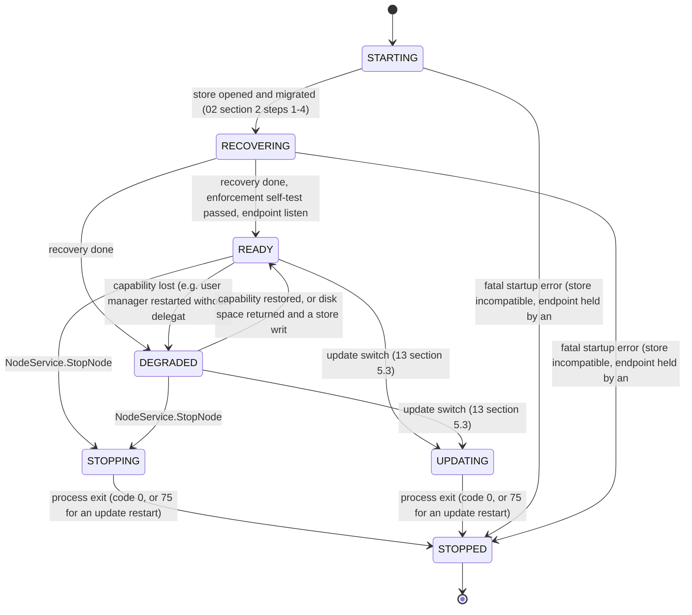

| From | To | Trigger | Guard | Effect |
|---|---|---|---|---|
| STARTING | RECOVERING | store opened and migrated (02 section 2 steps 1-4) |  |  |
| RECOVERING | READY | recovery done, enforcement self-test passed, endpoint listening |  |  |
| RECOVERING | DEGRADED | recovery done; some capability missing (OBSERVE_ONLY or PARTIAL) |  |  |
| READY | DEGRADED | capability lost (e.g. user manager restarted without delegation), or a store write failed for lack of disk space (reason store_out_of_space; 06 section 5) |  |  |
| DEGRADED | READY | capability restored, or disk space returned and a store write succeeded |  |  |
| READY, DEGRADED | STOPPING | NodeService.StopNode; OS logoff; service stop |  |  |
| READY, DEGRADED | UPDATING | update switch (13 section 5.3) |  |  |
| STOPPING, UPDATING | STOPPED | process exit (code 0, or 75 for an update restart) |  |  |
| STARTING, RECOVERING | STOPPED | fatal startup error (store incompatible, endpoint held by another instance) |  |  |

## SM-GUEST-LINK — WSL guest link (host side): retired 2026-10-21 by AD-0018, never entered; kept as history

- Enum: `arcforges.node.v1.GuestLinkState`; persisted: node store guest_link.state (retired table, never written); owner: none (the guest manager is retired by AD-0018).
- Initial: `NOT_INSTALLED`, `DISCOVERED`. Terminal: none (long-lived).

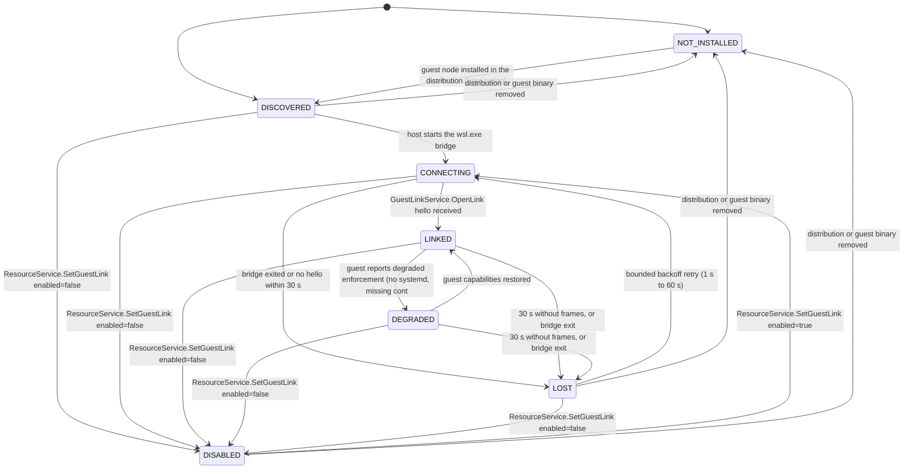

| From | To | Trigger | Guard | Effect |
|---|---|---|---|---|
| NOT_INSTALLED | DISCOVERED | guest node installed in the distribution (user action) |  |  |
| DISCOVERED | CONNECTING | host starts the wsl.exe bridge |  |  |
| CONNECTING | LINKED | GuestLinkService.OpenLink hello received | link token valid; protocol compatible |  |
| CONNECTING | LOST | bridge exited or no hello within 30 s |  |  |
| LINKED | DEGRADED | guest reports degraded enforcement (no systemd, missing controllers) |  |  |
| DEGRADED | LINKED | guest capabilities restored |  |  |
| LINKED, DEGRADED | LOST | 30 s without frames, or bridge exit |  | finding GUEST_LINK_LOST; the guest keeps its last allocation until lease_until, then admits only within the standalone allocation; the host keeps the guest's reserved allocation (the last acknowledged one and any larger unacknowledged push) until the guest acknowledges a smaller one after reconnecting, or its distribution is observed stopped (architecture 03 section 6) |
| LOST | CONNECTING | bounded backoff retry (1 s to 60 s) |  |  |
| DISCOVERED, CONNECTING, LINKED, DEGRADED, LOST | DISABLED | ResourceService.SetGuestLink enabled=false |  | the guest's reserved allocation stays, whether the link was up or lost, until the guest acknowledges a smaller one or its distribution is observed stopped (architecture 03 section 6) |
| DISABLED | CONNECTING | ResourceService.SetGuestLink enabled=true |  |  |
| DISCOVERED, LOST, DISABLED | NOT_INSTALLED | distribution or guest binary removed |  | the guest's reserved allocation stays, whether the link was up or lost, until the guest acknowledges a smaller one or its distribution is observed stopped (architecture 03 section 6) |

## SM-PAIRING — LAN pairing (local confirmation): out of current delivery since 2026-10-28 (AD-0021 §12); kept as history

- Enum: `arcforges.node.v1.PairingState`; persisted: node store pairing.state (secrets in memory); owner: Peer manager.
- Initial: `REQUESTED`, `INCOMING`. Terminal: `PAIRED`, `REJECTED`, `MISMATCH`, `EXPIRED`, `CANCELLED`, `BLOCKED`.

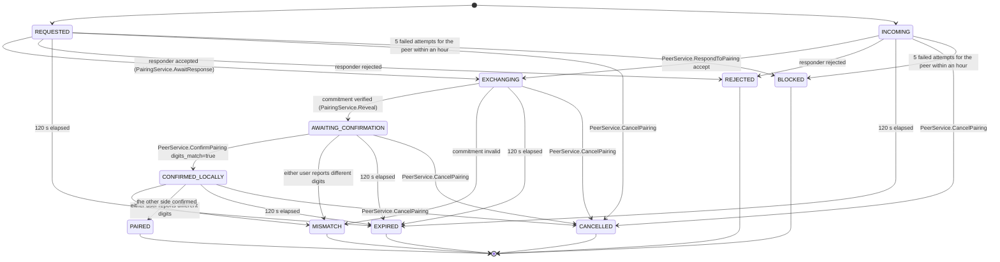

| From | To | Trigger | Guard | Effect |
|---|---|---|---|---|
| REQUESTED | EXCHANGING | responder accepted (PairingService.AwaitResponse) |  |  |
| INCOMING | EXCHANGING | PeerService.RespondToPairing accept |  |  |
| REQUESTED, INCOMING | REJECTED | responder rejected |  |  |
| EXCHANGING | AWAITING_CONFIRMATION | commitment verified (PairingService.Reveal); SAS computed |  |  |
| EXCHANGING | MISMATCH | commitment invalid |  |  |
| AWAITING_CONFIRMATION | CONFIRMED_LOCALLY | PeerService.ConfirmPairing digits_match=true |  |  |
| AWAITING_CONFIRMATION, CONFIRMED_LOCALLY | MISMATCH | either user reports different digits |  |  |
| CONFIRMED_LOCALLY | PAIRED | the other side confirmed |  | fingerprints pinned; peer PAIRED (PINNED); default policy status-only |
| REQUESTED, INCOMING, EXCHANGING, AWAITING_CONFIRMATION, CONFIRMED_LOCALLY | EXPIRED | 120 s elapsed |  |  |
| REQUESTED, INCOMING, EXCHANGING, AWAITING_CONFIRMATION, CONFIRMED_LOCALLY | CANCELLED | PeerService.CancelPairing; PairingService.Abort |  |  |
| REQUESTED, INCOMING | BLOCKED | 5 failed attempts for the peer within an hour |  |  |

## SM-REMOTE-ATTEMPT — Remote attempt (executor side): out of current delivery since 2026-10-28 (AD-0021 §12); kept as history

- Enum: `arcforges.peer.v1.RemoteAttemptState`; persisted: executor node store remote_attempt.state; origin mirrors as ATTEMPT_KIND_REMOTE; owner: Placement.
- Initial: `RESERVED`. Terminal: `RELEASED`, `CANCELLED`, `PREEMPTED`.

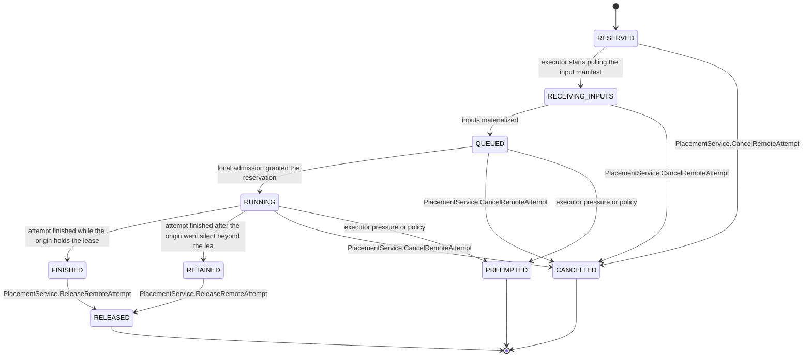

| From | To | Trigger | Guard | Effect |
|---|---|---|---|---|
| RESERVED | RECEIVING_INPUTS | executor starts pulling the input manifest |  |  |
| RECEIVING_INPUTS | QUEUED | inputs materialized |  |  |
| QUEUED | RUNNING | local admission granted the reservation |  |  |
| RUNNING | FINISHED | attempt finished while the origin holds the lease |  |  |
| RUNNING | RETAINED | attempt finished after the origin went silent beyond the lease (FINISH_AND_RETAIN) |  |  |
| FINISHED, RETAINED | RELEASED | PlacementService.ReleaseRemoteAttempt; retention (7 days) ended |  |  |
| RESERVED, RECEIVING_INPUTS, QUEUED, RUNNING | CANCELLED | PlacementService.CancelRemoteAttempt; lease expired with CANCEL; executor user cancelled |  |  |
| QUEUED, RUNNING | PREEMPTED | executor pressure or policy |  |  |

## SM-CLEANUP-PLAN — Cleanup plan

- Enum: `arcforges.node.v1.CleanupPlanState`; persisted: node store cleanup_plan.state; owner: Cleanup executor.
- Initial: `PLANNED`. Terminal: `COMPLETED`, `PARTIAL`, `EXPIRED`, `CANCELLED`.

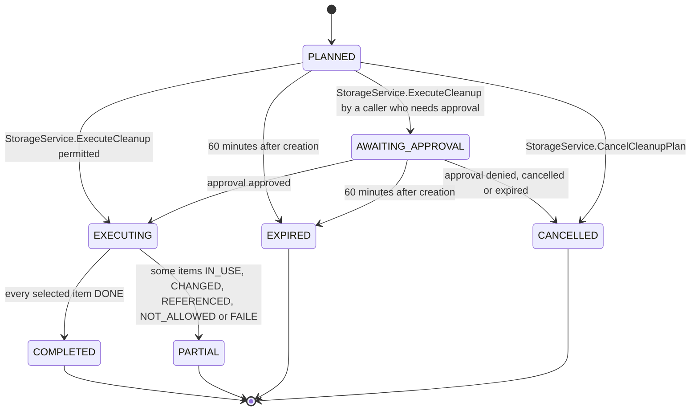

| From | To | Trigger | Guard | Effect |
|---|---|---|---|---|
| PLANNED | AWAITING_APPROVAL | StorageService.ExecuteCleanup by a caller who needs approval |  |  |
| PLANNED | EXECUTING | StorageService.ExecuteCleanup permitted | digest matches; not expired |  |
| AWAITING_APPROVAL | EXECUTING | approval approved |  |  |
| AWAITING_APPROVAL | CANCELLED | approval denied, cancelled or expired |  |  |
| EXECUTING | COMPLETED | every selected item DONE |  |  |
| EXECUTING | PARTIAL | some items IN_USE, CHANGED, REFERENCED, NOT_ALLOWED or FAILED |  |  |
| PLANNED, AWAITING_APPROVAL | EXPIRED | 60 minutes after creation |  |  |
| PLANNED | CANCELLED | StorageService.CancelCleanupPlan |  |  |

## SM-WORKTREE — Managed worktree

- Enum: `arcforges.node.v1.WorkspaceState`; persisted: node store workspace.state (kind MANAGED_WORKTREE); owner: Workspace manager.
- Initial: `CREATING`. Terminal: `REMOVED`.

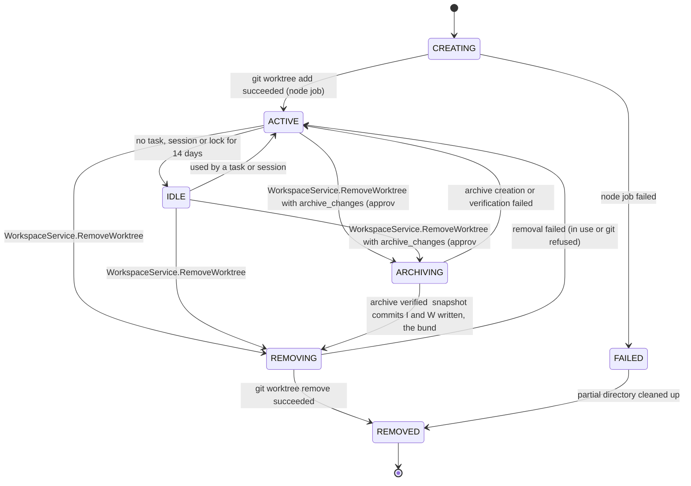

| From | To | Trigger | Guard | Effect |
|---|---|---|---|---|
| CREATING | ACTIVE | git worktree add succeeded (node job) |  |  |
| CREATING | FAILED | node job failed |  |  |
| ACTIVE | IDLE | no task, session or lock for 14 days |  |  |
| IDLE | ACTIVE | used by a task or session |  |  |
| ACTIVE, IDLE | REMOVING | WorkspaceService.RemoveWorktree; approved cleanup item | clean (no staged, unstaged or untracked changes) |  |
| ACTIVE, IDLE | ARCHIVING | WorkspaceService.RemoveWorktree with archive_changes (approved), with the ignored-files decision when the removal plan lists ignored files | dirty; nothing listed as blocking; no task, session or lock uses the worktree |  |
| ARCHIVING | REMOVING | archive verified: snapshot commits I and W written, the bundle fetched over the base ref into a temporary repository with the same commit IDs, live files matched by blob ID, mode and bytes, the index matched to I (06 section 3) |  |  |
| ARCHIVING | ACTIVE | archive creation or verification failed; nothing removed; finding raised |  |  |
| REMOVING | REMOVED | git worktree remove succeeded |  |  |
| REMOVING | ACTIVE | removal failed (in use or git refused) |  |  |
| FAILED | REMOVED | partial directory cleaned up |  |  |

## SM-SESSION — AI client session

- Enum: `arcforges.node.v1.SessionState`; persisted: node store session.state; owner: Session service.
- Initial: `ACTIVE`. Terminal: `ENDED`.

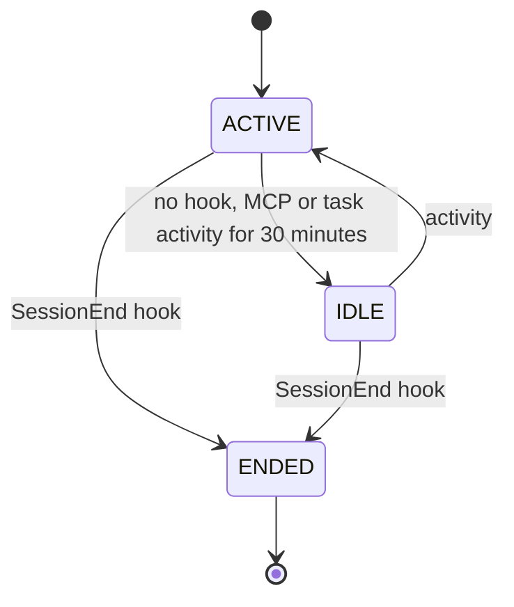

| From | To | Trigger | Guard | Effect |
|---|---|---|---|---|
| ACTIVE | IDLE | no hook, MCP or task activity for 30 minutes |  |  |
| IDLE | ACTIVE | activity |  |  |
| ACTIVE, IDLE | ENDED | SessionEnd hook; agent root process exited; 24 h inactivity; SessionService.EndSession |  | services with stop_with_session stop |

## SM-APPROVAL — Approval

- Enum: `arcforges.node.v1.ApprovalState`; persisted: node store approval.state; owner: Approval service.
- Initial: `PENDING`. Terminal: `EXECUTED`, `FAILED`, `DENIED`, `EXPIRED`, `CANCELLED`.

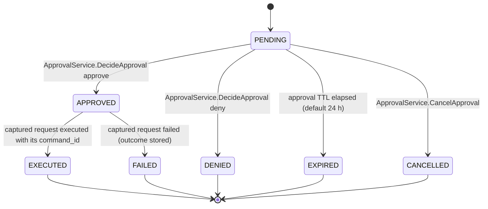

| From | To | Trigger | Guard | Effect |
|---|---|---|---|---|
| PENDING | APPROVED | ApprovalService.DecideApproval approve | approver HUMAN, or REMOTE with step-up and remote.allow_approvals |  |
| APPROVED | EXECUTED | captured request executed with its command_id |  |  |
| APPROVED | FAILED | captured request failed (outcome stored) |  |  |
| PENDING | DENIED | ApprovalService.DecideApproval deny |  |  |
| PENDING | EXPIRED | approval TTL elapsed (default 24 h) |  |  |
| PENDING | CANCELLED | ApprovalService.CancelApproval |  |  |

## SM-SIGN-IN — Node browser sign-in (cloud side)

- Enum: `arcforges.fleet.v1.NodeSignInState`; persisted: cloud fleet_node_sign_in.state; node mirrors as SignInFlowState; owner: Fleet module.
- Initial: `PENDING`. Terminal: `COMPLETED`, `DENIED`, `EXPIRED`, `REVOKED`.

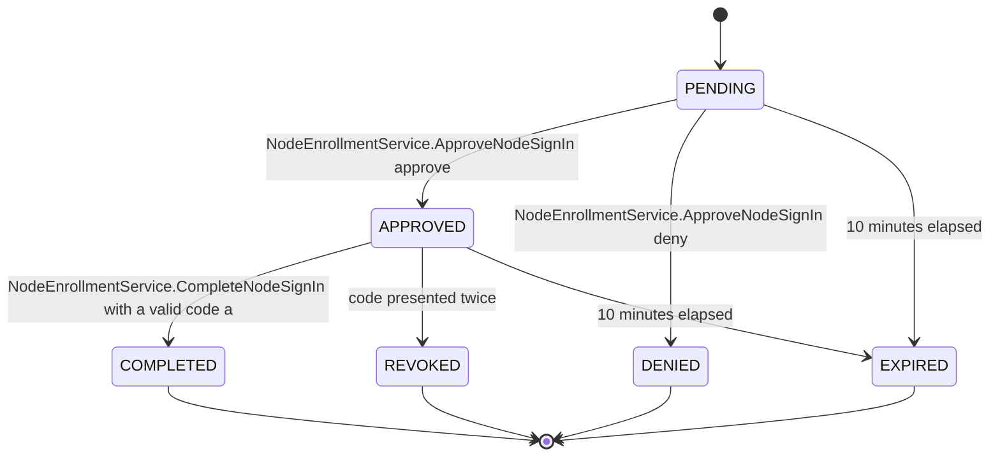

| From | To | Trigger | Guard | Effect |
|---|---|---|---|---|
| PENDING | APPROVED | NodeEnrollmentService.ApproveNodeSignIn approve |  | one-use code issued; browser redirected to the loopback URI |
| PENDING | DENIED | NodeEnrollmentService.ApproveNodeSignIn deny |  |  |
| APPROVED | COMPLETED | NodeEnrollmentService.CompleteNodeSignIn with a valid code and verifier |  | installation registered; credentials issued |
| APPROVED | REVOKED | code presented twice |  |  |
| PENDING, APPROVED | EXPIRED | 10 minutes elapsed |  |  |

## SM-DEVICE-AUTH — Device authorization (headless sign-in)

- Enum: `arcforges.fleet.v1.DeviceAuthorizationState`; persisted: cloud fleet_device_authorization.state; owner: Fleet module.
- Initial: `PENDING`. Terminal: `COMPLETED`, `DENIED`, `EXPIRED`.
- Response-only enum values (never stored): SLOW_DOWN.

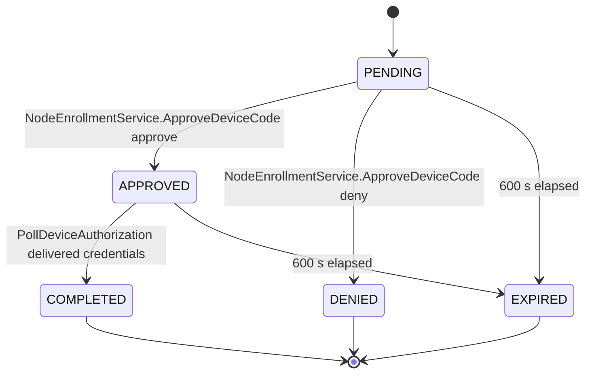

| From | To | Trigger | Guard | Effect |
|---|---|---|---|---|
| PENDING | APPROVED | NodeEnrollmentService.ApproveDeviceCode approve |  |  |
| PENDING | DENIED | NodeEnrollmentService.ApproveDeviceCode deny; 5 failed code entries |  |  |
| APPROVED | COMPLETED | PollDeviceAuthorization delivered credentials |  |  |
| PENDING, APPROVED | EXPIRED | 600 s elapsed |  |  |

## SM-PHONE-PAIRING — Phone sign-in by QR

- Enum: `arcforges.fleet.v1.PhonePairingCloudState`; persisted: cloud fleet_phone_pairing.state; node mirrors as PhonePairingState; owner: Fleet module.
- Initial: `WAITING_FOR_SCAN`. Terminal: `COMPLETED`, `DENIED`, `EXPIRED`, `CONSUMED`.

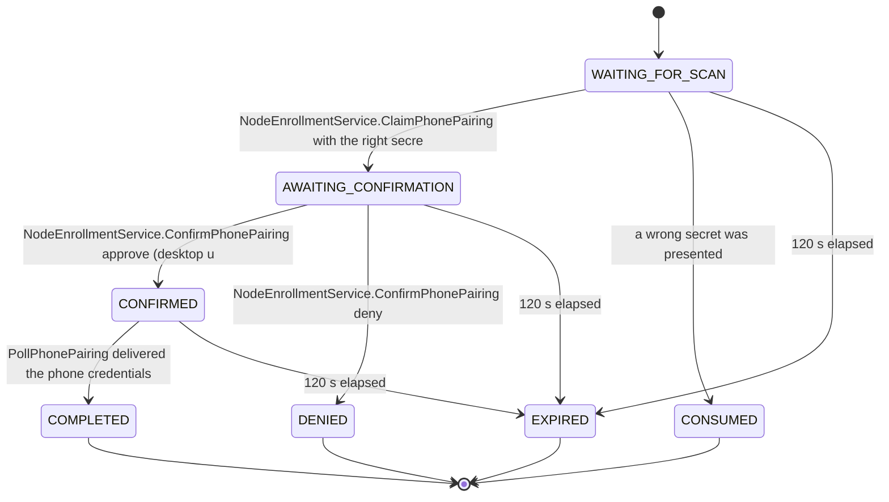

| From | To | Trigger | Guard | Effect |
|---|---|---|---|---|
| WAITING_FOR_SCAN | AWAITING_CONFIRMATION | NodeEnrollmentService.ClaimPhonePairing with the right secret |  |  |
| WAITING_FOR_SCAN | CONSUMED | a wrong secret was presented |  |  |
| AWAITING_CONFIRMATION | CONFIRMED | NodeEnrollmentService.ConfirmPhonePairing approve (desktop user) |  |  |
| AWAITING_CONFIRMATION | DENIED | NodeEnrollmentService.ConfirmPhonePairing deny |  |  |
| CONFIRMED | COMPLETED | PollPhonePairing delivered the phone credentials |  |  |
| WAITING_FOR_SCAN, AWAITING_CONFIRMATION, CONFIRMED | EXPIRED | 120 s elapsed |  |  |

## SM-RELAY — Relay connection (node side) (since 2026-10-28 the node's connection to the Go center, AD-0021 §9)

- Enum: `arcforges.node.v1.RelayState`; persisted: in memory; reported in AccountStatus; owner: Cloud link.
- Initial: `DISABLED`. Terminal: none (long-lived).

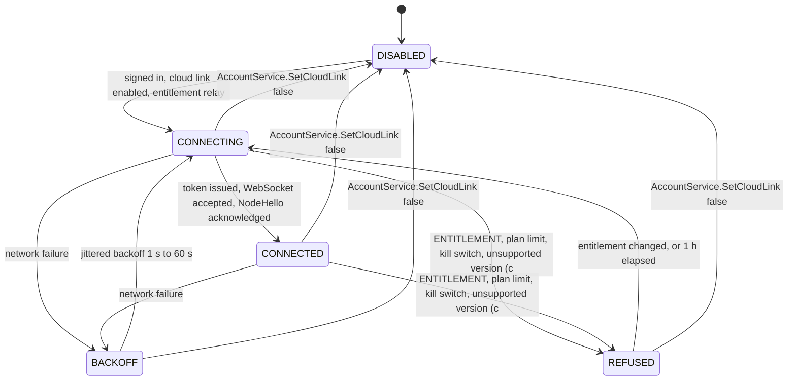

| From | To | Trigger | Guard | Effect |
|---|---|---|---|---|
| DISABLED | CONNECTING | signed in, cloud link enabled, entitlement relay |  |  |
| CONNECTING | CONNECTED | token issued, WebSocket accepted, NodeHello acknowledged |  |  |
| CONNECTING, CONNECTED | BACKOFF | network failure; close 4401, 4408 or 4429; container unavailable |  |  |
| BACKOFF | CONNECTING | jittered backoff 1 s to 60 s |  |  |
| CONNECTING, CONNECTED | REFUSED | ENTITLEMENT, plan limit, kill switch, unsupported version (close 4403 or 4503) |  |  |
| REFUSED | CONNECTING | entitlement changed, or 1 h elapsed |  |  |
| CONNECTING, CONNECTED, BACKOFF, REFUSED | DISABLED | AccountService.SetCloudLink false; sign-out; node revoked |  |  |

## SM-REMOTE-COMMAND — Remote command (since 2026-10-28 center-routed signed calls, AD-0021 §10)

- Enum: `arcforges.fleet.v1.RemoteCommandState`; persisted: cloud fleet_remote_command.state; node remote_command_log; owner: Fleet module.
- Initial: `ACCEPTED`. Terminal: `SUCCEEDED`, `FAILED`, `REJECTED_BY_NODE`, `EXPIRED`, `CANCELLED`.

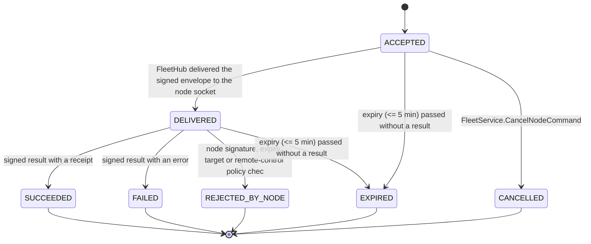

| From | To | Trigger | Guard | Effect |
|---|---|---|---|---|
| ACCEPTED | DELIVERED | FleetHub delivered the signed envelope to the node socket |  |  |
| DELIVERED | SUCCEEDED | signed result with a receipt |  |  |
| DELIVERED | FAILED | signed result with an error |  |  |
| DELIVERED | REJECTED_BY_NODE | node signature, expiry, target or remote-control policy check failed |  |  |
| ACCEPTED, DELIVERED | EXPIRED | expiry (<= 5 min) passed without a result |  | never executed late |
| ACCEPTED | CANCELLED | FleetService.CancelNodeCommand |  |  |

## SM-SUBSCRIPTION — Subscription (normalized across Paddle and Google Play)

- Enum: `arcforges.fleet.v1.SubscriptionState`; persisted: cloud commerce_subscription (reused) with provider state; fleet_play_purchase.play_state; owner: Commerce module.
- Initial: `PENDING`, `ACTIVE`, `TRIALING`. Terminal: `EXPIRED`, `REVOKED`.

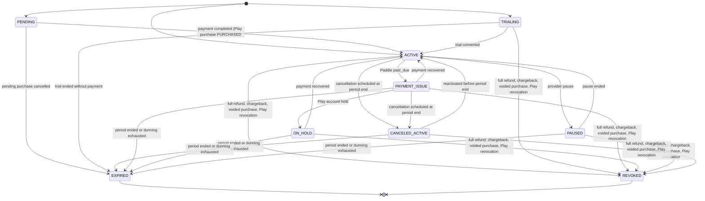

| From | To | Trigger | Guard | Effect |
|---|---|---|---|---|
| PENDING | ACTIVE | payment completed (Play purchase PURCHASED; Paddle subscription active) |  |  |
| PENDING | EXPIRED | pending purchase cancelled |  |  |
| TRIALING | ACTIVE | trial converted |  |  |
| TRIALING | EXPIRED | trial ended without payment |  |  |
| ACTIVE | PAYMENT_ISSUE | Paddle past_due; Play grace period |  |  |
| PAYMENT_ISSUE | ACTIVE | payment recovered |  |  |
| PAYMENT_ISSUE | ON_HOLD | Play account hold |  |  |
| ON_HOLD | ACTIVE | payment recovered |  |  |
| ACTIVE | PAUSED | provider pause |  |  |
| PAUSED | ACTIVE | pause ended |  |  |
| ACTIVE, PAYMENT_ISSUE | CANCELED_ACTIVE | cancellation scheduled at period end |  |  |
| CANCELED_ACTIVE | ACTIVE | reactivated before period end |  |  |
| CANCELED_ACTIVE, PAYMENT_ISSUE, ON_HOLD, PAUSED | EXPIRED | period ended or dunning exhausted |  |  |
| ACTIVE, TRIALING, PAYMENT_ISSUE, ON_HOLD, PAUSED, CANCELED_ACTIVE | REVOKED | full refund, chargeback, voided purchase, Play revocation |  | entitlement removed immediately |

## SM-UPDATE — Node update

- Enum: `arcforges.node.v1.UpdateState`; persisted: node store update_state.state; run/update-switch.json during a switch; owner: Updater.
- Initial: `IDLE`, `MANAGED_EXTERNALLY`. Terminal: `MANAGED_EXTERNALLY`.

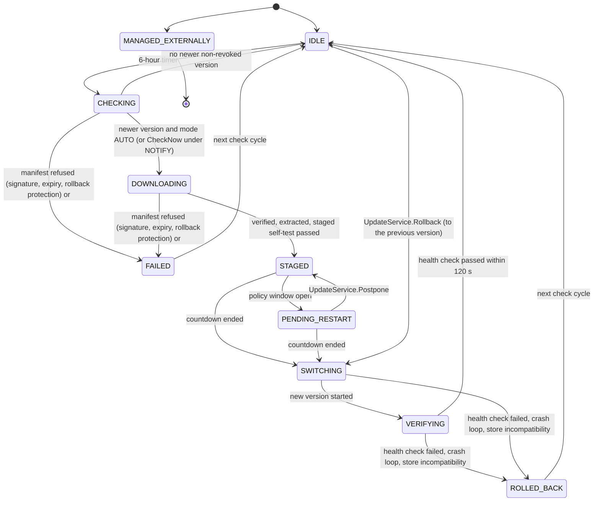

| From | To | Trigger | Guard | Effect |
|---|---|---|---|---|
| IDLE | CHECKING | 6-hour timer; UpdateService.CheckNow |  |  |
| CHECKING | IDLE | no newer non-revoked version |  |  |
| CHECKING | DOWNLOADING | newer version and mode AUTO (or CheckNow under NOTIFY) |  |  |
| CHECKING, DOWNLOADING | FAILED | manifest refused (signature, expiry, rollback protection) or digest mismatch |  |  |
| DOWNLOADING | STAGED | verified, extracted, staged self-test passed |  |  |
| STAGED | PENDING_RESTART | policy window open; restart announced |  |  |
| STAGED, PENDING_RESTART | SWITCHING | countdown ended; UpdateService.ApplyNow |  |  |
| PENDING_RESTART | STAGED | UpdateService.Postpone |  |  |
| SWITCHING | VERIFYING | new version started |  |  |
| VERIFYING | IDLE | health check passed within 120 s |  | new version ACTIVE; previous kept |
| VERIFYING, SWITCHING | ROLLED_BACK | health check failed, crash loop, store incompatibility |  | finding UPDATE_FAILED; version marked BAD |
| IDLE | SWITCHING | UpdateService.Rollback (to the previous version) |  |  |
| ROLLED_BACK, FAILED | IDLE | next check cycle |  |  |

## SM-INTEGRATION — AI client integration

- Enum: `arcforges.node.v1.IntegrationState`; persisted: derived from integration_write, client settings and probes (re-evaluated by file watchers); owner: Integration service.
- Initial: `CLIENT_NOT_FOUND`, `NOT_CONFIGURED`. Terminal: none (long-lived).

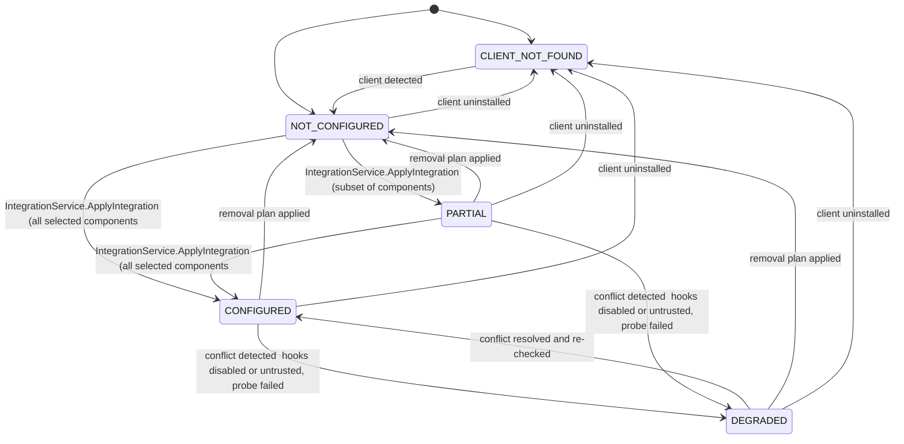

| From | To | Trigger | Guard | Effect |
|---|---|---|---|---|
| CLIENT_NOT_FOUND | NOT_CONFIGURED | client detected |  |  |
| NOT_CONFIGURED, PARTIAL | CONFIGURED | IntegrationService.ApplyIntegration (all selected components) |  |  |
| NOT_CONFIGURED | PARTIAL | IntegrationService.ApplyIntegration (subset of components) |  |  |
| CONFIGURED, PARTIAL | DEGRADED | conflict detected: hooks disabled or untrusted, probe failed, configuration edited away |  |  |
| DEGRADED | CONFIGURED | conflict resolved and re-checked |  |  |
| CONFIGURED, PARTIAL, DEGRADED | NOT_CONFIGURED | removal plan applied |  |  |
| NOT_CONFIGURED, CONFIGURED, PARTIAL, DEGRADED | CLIENT_NOT_FOUND | client uninstalled |  |  |
