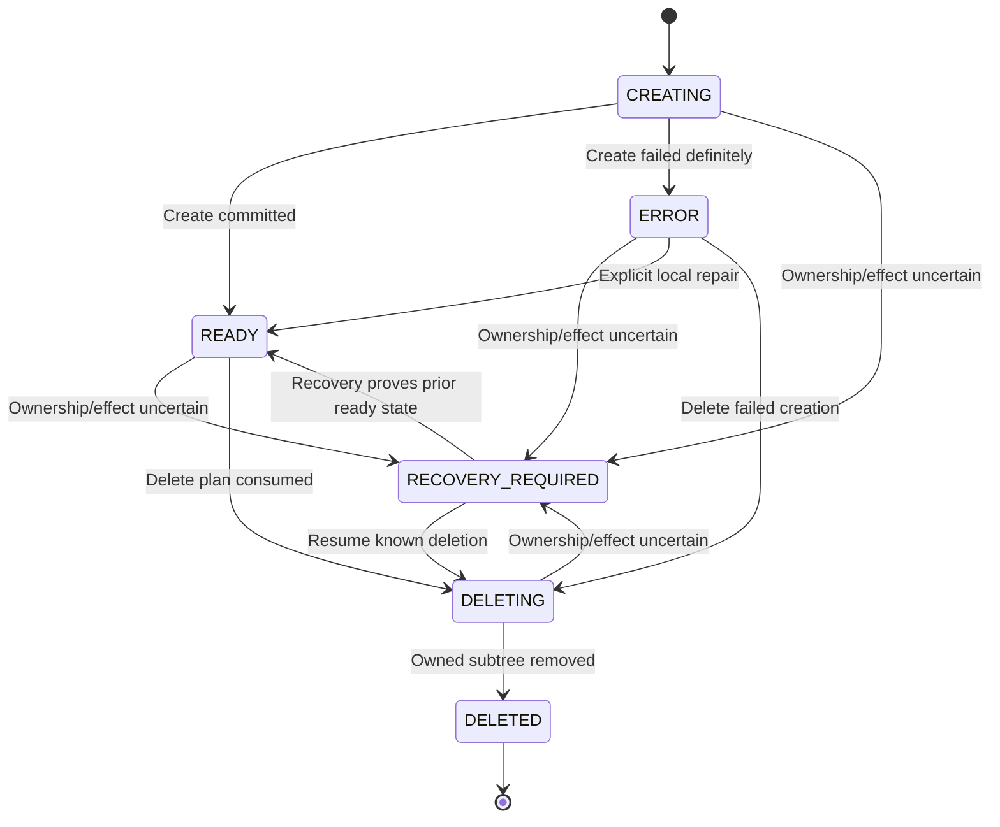
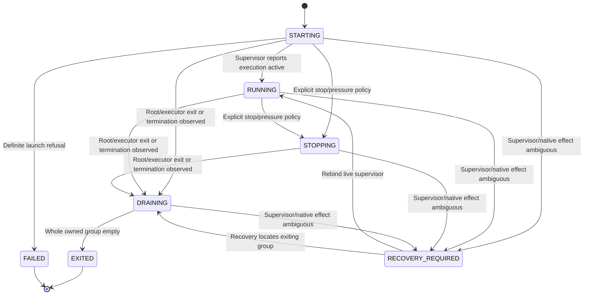
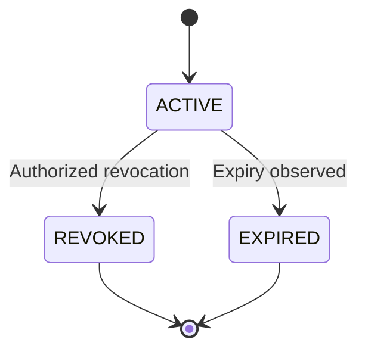
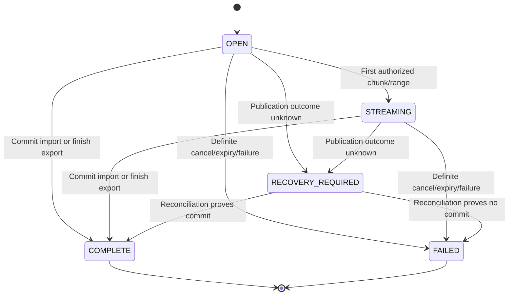
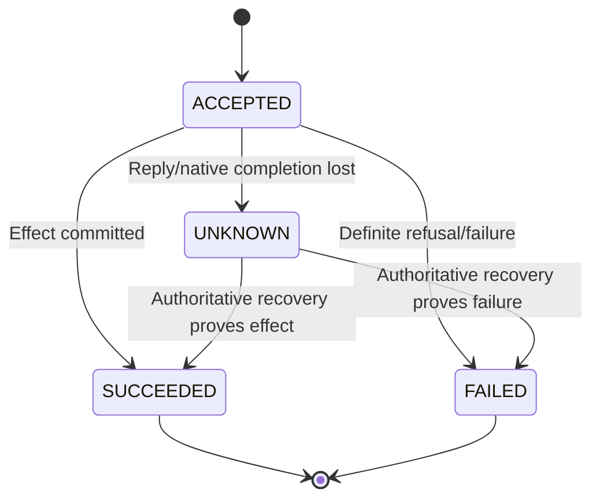
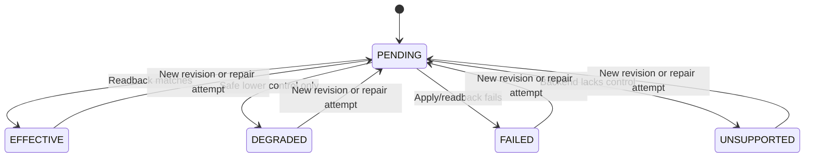

# State machines

Generated by `tools/check_design.py --write` from [machines.json](machines.json). Do not edit by hand.
States equal the named proto enum values (without the enum prefix), or an explicitly sourced non-wire stored state map; pseudo-states are marked.

| ID | Machine | State authority | Persisted | Owner |
|---|---|---|---|---|
| [SM-SANDBOX](#sm-sandbox) | Persistent Sandbox | `arcforges.sandbox.v2.SandboxState` | True | Sandbox Core |
| [SM-RUN](#sm-run) | Managed execution | `arcforges.sandbox.v2.RunState` | True | RunSupervisor and Node reconciliation |
| [SM-GRANT](#sm-grant) | Local remote grant | `arcforges.sandbox.v2.GrantState` | True | Local owner/Sandbox Core |
| [SM-TRANSFER](#sm-transfer) | Owned import/export | `arcforges.sandbox.v2.TransferState` | True | Sandbox data manager |
| [SM-OPERATION](#sm-operation) | Node mutation receipt | `arcforges.sandbox.v2.OperationState` | True | Node command processor |
| [SM-LIMIT](#sm-limit) | Requested/applied/read-back limit | `arcforges.sandbox.v2.LimitStatus` | False | Resource manager |

## SM-SANDBOX — Persistent Sandbox

- Enum: `arcforges.sandbox.v2.SandboxState`; persisted: True; owner: Sandbox Core.
- Initial: `CREATING`. Terminal: `DELETED`.

| From | To | Trigger | Guard | Effect |
|---|---|---|---|---|
| CREATING | READY | Create committed | Private root manifest and configuration verified | Commit revision and ready event |
| CREATING | ERROR | Create failed definitely | Owned partial state identified; no Run admitted | Persist reason and cleanup identity |
| CREATING, READY, DELETING, ERROR | RECOVERY_REQUIRED | Ownership/effect uncertain | Identity or journal cannot be reconciled | Refuse conflicting starts and preserve evidence |
| ERROR | READY | Explicit local repair | Ownership and profile valid; no unresolved effect | Commit corrected config |
| READY | DELETING | Delete plan consumed | Revision/root unchanged; no nonterminal Run or transfer; ownership lock | Block starts and journal quarantine intent |
| ERROR | DELETING | Delete failed creation | Owned path verified; no use | Journal exact owned cleanup |
| DELETING | DELETED | Owned subtree removed | Independent identity checks; no external grant included | Commit tombstone and receipt |
| RECOVERY_REQUIRED | READY | Recovery proves prior ready state | Authenticated ownership and no pending destructive effect | Commit reconciliation |
| RECOVERY_REQUIRED | DELETING | Resume known deletion | Same root/journal identity and no managed use | Resume exact intent without new ID |

## SM-RUN — Managed execution

- Enum: `arcforges.sandbox.v2.RunState`; persisted: True; owner: RunSupervisor and Node reconciliation.
- Initial: `STARTING`. Terminal: `EXITED`, `FAILED`.

| From | To | Trigger | Guard | Effect |
|---|---|---|---|---|
| STARTING | RUNNING | Supervisor reports execution active | Confinement/resource prerequisites applied; supervised executor identity bound | Record started time; payload_started may remain UNKNOWN |
| STARTING | FAILED | Definite launch refusal | No payload effect; outer owned group empty verified | Record failure and release grant |
| STARTING, RUNNING | STOPPING | Explicit stop/pressure policy | Actor authorized; owned boundary identity verified | Persist stop intent and issue tested graceful signal |
| STARTING, RUNNING, STOPPING | DRAINING | Root/executor exit or termination observed | Authoritative observation provenance; no terminal-text parsing | Record raw exit; drain descendants and retain ownership |
| DRAINING | EXITED | Whole owned group empty | Native outer boundary empty independently confirmed | Persist final reason/exit and release grant |
| STARTING, RUNNING, STOPPING, DRAINING | RECOVERY_REQUIRED | Supervisor/native effect ambiguous | Cannot authenticate ownership/completion | Block conflicting cleanup; retain reservation and evidence |
| RECOVERY_REQUIRED | RUNNING | Rebind live supervisor | Same boot/process creation/Run epoch and confinement; no Start replay | Restore observations and require fresh terminal lease |
| RECOVERY_REQUIRED | DRAINING | Recovery locates exiting group | Verified ownership or host reboot proof | Finish cleanup and final record |

## SM-GRANT — Local remote grant

- Enum: `arcforges.sandbox.v2.GrantState`; persisted: True; owner: Local owner/Sandbox Core.
- Initial: `ACTIVE`. Terminal: `REVOKED`, `EXPIRED`.

| From | To | Trigger | Guard | Effect |
|---|---|---|---|---|
| ACTIVE | REVOKED | Authorized revocation | Local owner or permitted remote narrowing | Advance revision and reject future stale commands |
| ACTIVE | EXPIRED | Expiry observed | Trusted local time policy; finite grant | Refuse future remote use; local runs continue |

## SM-TRANSFER — Owned import/export

- Enum: `arcforges.sandbox.v2.TransferState`; persisted: True; owner: Sandbox data manager.
- Initial: `OPEN`. Terminal: `COMPLETE`, `FAILED`.

| From | To | Trigger | Guard | Effect |
|---|---|---|---|---|
| OPEN | STREAMING | First authorized chunk/range | Identity, expiry, no-use lock and quota valid | Advance contiguous verified cursor |
| OPEN, STREAMING | COMPLETE | Commit import or finish export | Exact length/hash and final root identity verified | Persist receipt then release staging |
| OPEN, STREAMING | FAILED | Definite cancel/expiry/failure | No uncertain publication effect | Remove only known staging; retain reason |
| OPEN, STREAMING | RECOVERY_REQUIRED | Publication outcome unknown | Durable intent exists but native result absent | Hold journal and staging identity |
| RECOVERY_REQUIRED | COMPLETE | Reconciliation proves commit | Exact destination/source version matches original intent | Return original receipt |
| RECOVERY_REQUIRED | FAILED | Reconciliation proves no commit | Owned staging and absence/rejection proven | Safely release with original failure |

## SM-OPERATION — Node mutation receipt

- Enum: `arcforges.sandbox.v2.OperationState`; persisted: True; owner: Node command processor.
- Initial: `ACCEPTED`. Terminal: `SUCCEEDED`, `FAILED`.

| From | To | Trigger | Guard | Effect |
|---|---|---|---|---|
| ACCEPTED | SUCCEEDED | Effect committed | Outcome and aggregate revision durable | Return same receipt for repeated ID |
| ACCEPTED | FAILED | Definite refusal/failure | Effect certainty known and recorded | Return immutable failure |
| ACCEPTED | UNKNOWN | Reply/native completion lost | Accepted effect might have happened | Require GetOperation reconciliation; no new-ID retry |
| UNKNOWN | SUCCEEDED | Authoritative recovery proves effect | Matches command and canonical payload | Finalize once |
| UNKNOWN | FAILED | Authoritative recovery proves failure | No conflicting effect; preserved audit | Finalize once |

## SM-LIMIT — Requested/applied/read-back limit

- Enum: `arcforges.sandbox.v2.LimitStatus`; persisted: False; owner: Resource manager.
- Initial: `PENDING`. Terminal: none (long-lived).

| From | To | Trigger | Guard | Effect |
|---|---|---|---|---|
| PENDING | EFFECTIVE | Readback matches | Correct boundary identity/value/metric verified | Expose applied and observed values/times |
| PENDING | DEGRADED | Safe lower control only | Requested policy not fully honored but safety preserved | Explain degraded metric; reject unsafe admission |
| PENDING | FAILED | Apply/readback fails | Cannot establish requested safety | Freeze increases; stop/refuse as policy requires |
| PENDING | UNSUPPORTED | Backend lacks control | Capability receipt identifies missing dimension | Reject requirements needing this control |
| EFFECTIVE, DEGRADED, FAILED, UNSUPPORTED | PENDING | New revision or repair attempt | New policy/qualification identity; no stale success reuse | Reapply and read back independently |
